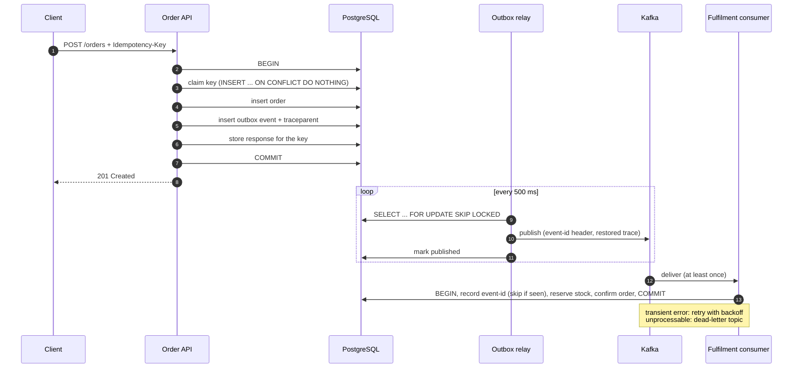

# reliable-orders

[](https://github.com/afrid09/reliable-orders/actions/workflows/ci.yml)

An order service built around one rule: **an order is never lost and never applied twice**, even when clients retry, processes crash mid-request, and Kafka redelivers messages.

Java 17 · Spring Boot 3 · PostgreSQL · Kafka · OpenTelemetry · Testcontainers

## The problem

Creating an order looks like two steps: save it, then tell the rest of the system. Each step can fail independently, and every naive fix creates a new bug.

| What goes wrong | What the customer sees |
|---|---|
| The client times out and retries, but the first request actually succeeded | Charged twice, two orders |
| Two retries arrive at the same moment | Both pass a "does this key exist?" check, two orders |
| The order commits, then the process dies before publishing to Kafka | Order exists, nothing downstream ever hears about it |
| The event is published, then the database commit fails | Downstream reserves stock for an order that doesn't exist |
| Kafka redelivers a message after a consumer restart | Stock reserved twice |
| A malformed message arrives | The consumer retries it forever and the partition stops moving |
| Something is slow | The trace stops at the database, so nobody can see where |

## How each one is handled



**1. Idempotency keys, enforced by the database.** Every `POST /orders` needs an `Idempotency-Key` header. Claiming the key, writing the order and event, and storing the response all happen in **one transaction**. A retry gets the stored response back byte for byte, with `Idempotent-Replayed: true`. Reusing a key with a different body is rejected with `422`.
Concurrent duplicates are handled by the primary key, not by a "check then insert": PostgreSQL makes the second `INSERT ... ON CONFLICT` wait for the first transaction to finish, then it sees the committed key and replays. There's no window where both pass.
→ [`IdempotencyService`](src/main/java/io/github/afrid09/reliableorders/idempotency/IdempotencyService.java)

**2. Transactional outbox instead of dual writes.** The request never talks to Kafka. The event is a row in `outbox_events`, committed with the order, so it exists if and only if the order does. A relay publishes committed rows and marks them done.
→ [`OrderService`](src/main/java/io/github/afrid09/reliableorders/order/OrderService.java), [`OutboxRelay`](src/main/java/io/github/afrid09/reliableorders/outbox/OutboxRelay.java)

**3. Safe to scale the relay.** Batches are claimed with `FOR UPDATE SKIP LOCKED`, so several instances share the work without double-publishing or blocking each other. On a failed send the relay stops the batch, which preserves per-order ordering, and records the error on the row.

**4. Exactly-once effect on top of at-least-once delivery.** The relay can crash after Kafka acknowledged an event but before marking it published, so the event gets sent again. The consumer records each `event-id` in `processed_events` **in the same transaction** as its side effects. If anything fails, the marker rolls back too, so the retry starts clean.
→ [`OrderEventsListener`](src/main/java/io/github/afrid09/reliableorders/fulfillment/OrderEventsListener.java)

**5. Retries for transient errors, a dead-letter topic for poison messages.** Transient failures are retried in place with exponential backoff. Messages that can never succeed, like invalid JSON, skip retries and go straight to `orders.events.DLT` with the exception recorded in headers, so the partition keeps flowing.
→ [`KafkaConfig`](src/main/java/io/github/afrid09/reliableorders/config/KafkaConfig.java)

**6. One trace across the async gap.** The W3C `traceparent` is saved with the outbox row and restored by the relay, so HTTP request → outbox → Kafka → consumer appear as **one trace** in Jaeger, even though they run on different threads, seconds apart.
→ [`TraceContextCodec`](src/main/java/io/github/afrid09/reliableorders/tracing/TraceContextCodec.java)

## Tests that prove it

Every test runs the real application against real PostgreSQL and Kafka (Testcontainers), not mocks.

| Test | What it proves |
|---|---|
| `IdempotencyTest.retryWithSameKey...` | A retry returns the identical response and creates one order and one event |
| `IdempotencyTest.concurrentDuplicates...` | 8 simultaneous requests with one key → exactly one order, 7 replays |
| `IdempotencyTest.reusingAKey...` | Same key, different body → `422` |
| `OutboxTest.rolledBackOrder...` | A crash after writing the order leaves **no** event behind |
| `OutboxTest.committedOrder...` | Committed orders are published and fulfilled end to end |
| `OutboxTest.redeliveredEvent...` | The same event delivered 3 times is applied once |
| `RetryAndDeadLetterTest.transientFailure...` | A dependency failing twice is retried until it succeeds, applied once |
| `RetryAndDeadLetterTest.poisonMessage...` | Malformed JSON goes to the DLT without blocking the partition |
| `TracingTest` | The Kafka record carries the same trace ID as the original HTTP request |

```bash
mvn verify   # needs Docker for Testcontainers
```

## Run it

```bash
docker compose up --build
```

```bash
# Create an order
curl -i -X POST localhost:8080/orders \
  -H 'Content-Type: application/json' \
  -H 'Idempotency-Key: 3f1c2a9e-demo' \
  -d '{"customerId":"c-42","sku":"WIDGET-1","quantity":2,"amountCents":4999}'

# Send exactly the same request again: same order ID, Idempotent-Replayed: true
# A moment later the order is CONFIRMED by the consumer
curl localhost:8080/orders/<id>
```

Open Jaeger at http://localhost:16686 and search for service `reliable-orders` to see the full trace.

## Design decisions and trade-offs

- **Outbox polling instead of CDC (Debezium).** Polling needs nothing beyond Postgres and is easy to reason about. The cost is latency (up to one poll interval) and some query load. At high volume I'd switch the relay to Debezium's outbox event router and keep the same table.
- **At-least-once plus dedup instead of Kafka transactions.** Kafka's exactly-once only covers Kafka-to-Kafka. The side effect here is a database write, so the reliable fix is an idempotent consumer, which also protects against redelivery from any other source.
- **The idempotency key stores the whole response.** That costs storage, but a retry gets exactly what the first call got, even after the order changes state. Production would add a TTL cleanup job.
- **Retry in place, not retry topics.** In-place retries keep ordering per order key, at the cost of briefly blocking the partition. For long outages, non-blocking retry topics (`@RetryableTopic`) would be the next step.
- **Dedup and side effects share one transaction.** That only works because both live in the same database. If the side effect were an external API, I'd pass the `event-id` through as that API's idempotency key.
